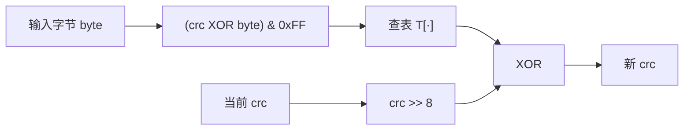

---
hide:
  - navigation
title: CRC（循环冗余校验）原理
tags:
  - knowledge
  - algorithms
  - crc
  - checksum
  - error-detection
categories:
  - algorithms
---

# CRC（循环冗余校验）原理

> 一句话讲透：**把数据看成一个 GF(2) 上的多项式，用一个约定好的生成多项式
> 做「模 2 长除法」，把余数当校验值；接收方对「数据 + 校验值」做同样的除法，
> 余数为 0 就认为没出错。**
>
> 本文只讲**逻辑**：它在算什么、为什么这样算就能发现错误、工程上如何把
> 「逐位长除法」变成一次查表。目的不是给你一份实现，而是让你能在白纸上把
> 这个算法重新推一遍。

## 它到底解决什么问题

数据在链路、磁盘、内存里传输存储时，比特会翻转（噪声、硬件故障、半写）。
我们希望额外附加一个**短**、**算得快**、**纯软件可实现**的冗余量，用来
高概率地发现「收到的数据和发出的不一样」。

CRC 的定位必须先划清：

| 能力             | CRC                   | 密码学哈希（SHA-256 / HMAC）        |
| ---------------- | --------------------- | ----------------------------------- |
| 发现随机比特翻转 | ✅ 强                 | ✅ 更强                             |
| 纠错             | ❌                    | ❌                                  |
| 防篡改 / 抗伪造  | ❌ 无密钥，可构造碰撞 | ✅ 有密钥时（HMAC）或抗碰撞（哈希） |
| 速度             | 纳秒级 / GB/s         | 慢几十倍                            |
| 长度             | 8 / 16 / 32 / 64 bit  | 128 / 256 / 512 bit                 |

所以：**CRC 是「错误检测」，不是「加密」，也不是「防篡改」**。拿 CRC 当
完整性签名（攻击者能让改过的数据保持同一 CRC）是经典误用。

同类手段的能力排序（同样长度的冗余）：

| 手段                | 能力                                                      | 成本                |
| ------------------- | --------------------------------------------------------- | ------------------- |
| 奇偶校验（parity）  | 只能发现奇数个比特错误，漏检率高                          | 几乎为零            |
| 加法校验和（sum）   | 对字节顺序、零字节不敏感；整段移位/交换常常无感           | 很便宜              |
| Fletcher / Adler-32 | 位置敏感，比 sum 强很多（ZFS 元数据用过 Fletcher）        | 便宜                |
| **CRC**             | 对突发错误（burst）有**确定**的检出保证，位级错误概率可控 | 一次查表 / 一条指令 |
| 密码学哈希          | 抗碰撞，但为防篡改设计，代价高                            | 慢                  |

## 数学基础：一串比特就是一个多项式

CRC 的全部魔法来自一个换视角的动作：**把比特串看成系数只有 0/1 的多项式**，
最高位对应最高次项。

```text
比特串  1 0 1 1
       │ │ │ └── x⁰ → 1
       │ │ └──── x¹ → 1
       │ └────── x² → 0
       └──────── x³ → 1
多项式 x³ + x + 1
```

在 GF(2)（系数只有 0/1 的有限域）上做运算，性质和我们熟悉的多项式略有不同：

- **加法 = 减法 = 按位异或（XOR）**。没有进位、没有借位：`1 + 1 = 0`。
  这一步是 CRC 高效的全部原因 —— 除法里的"减法"从带借位的整数减法变成了
  一条 XOR 指令。
- 乘法 = 无进位乘法（后来 CLMUL 这类"carry-less multiply"指令就是干这个的）。
- 最高位固定为 1 的多项式可以用剩余低位唯一表示（所以 `0x04C11DB7` 这样的
  参数其实省略了 `x³²` 那一项）。
- 关键性质 1：**A XOR A = 0**。
- 关键性质 2：**若 A 能被 G 整除，且 C 能被 G 整除，则 A XOR C 也能被 G 整除**
  （线性的来源，后面讲分段/并行全靠它）。

## 核心运算：模 2 长除法

和小学竖式除法一样，只是每一步的"减"换成 XOR，而且"够不够减"只看**当前最
高位是不是 1**（是 1 才 XOR 除数，等价于商的这一位取 1；是 0 就跳过）。

```text
                     1 0 1                ← 商（实际只关心余数）
               ┌──────────
1 0 1 1        │ 1 1 0 1 0 1
                 1 0 1 1                ← 对齐被除数的最高位 1，按位 XOR
                 ─────────
                 0 1 1 0 0 1
                   1 0 1 1              ← 最高位仍为 1，继续 XOR
                   ─────────
                   0 0 1 1 1 1
                     1 0 1 1
                     ─────────
                     0 0 0 1 0 0        ← 余数 100
```

两个值得记住的结论：

- 余数的**宽度固定 = 除数位数 − 1**（除数最高位恒为 1，所以 r 位余数 ⇔
  r+1 位除数）。CRC-32 就是"除数是 33 位多项式、余数是 32 位"。
- 整个过程只需要：一次 `<<`、一次比较最高位、一次 XOR。**逐位实现天然就是
  这个形状**。

## CRC 的定义

约定一个 **r+1 位生成多项式 `G(x)`**（最高位为 1，如 `1011` 即 x³+x+1），
对数据 `M(x)` 做：

```text
① 数据左移 r 位：M(x) · x^r        —— 即数据后补 r 个 0，给校验值腾位置
② 求余数：        CRC = (M·x^r) mod G
③ 组帧：          帧 = 数据 ‖ CRC   （CRC 占 r 位，高位补 0 到 r 位）
④ 校验：          帧 mod G == 0 ?   —— 接收方把整帧直接除以 G，余数为 0 即通过
```

为什么 ④ 会成立（这就是 CRC 那句"余数为 0 就对"的来历）：

```text
M·x^r 除以 G  ⇒  M·x^r = Q·G XOR CRC
两边同时 XOR CRC：  M·x^r XOR CRC = Q·G
而 帧 = M·x^r XOR CRC（拼接恰好等价于异或，因为低 r 位原来是 0）
∴ 帧 一定能被 G 整除
```

注意这里**不是"数据能被整除"**，而是"数据左移 r 位后补上余数、整体能被
整除"。所以 CRC 值本身没有任何独立含义，它就是"余数"。

一个小例子（G = `1011`，即 x³+x+1，r = 3；数据 M = `11010`）：

```text
M            11010
M · x³       11010000        （补 3 个 0）
÷ 1011 取余  010            （按上面的长除法）
帧           11010 010  = 11010010
验证：11010010 ÷ 1011 → 余数 000  ✅
```

## 为什么这样一个余数能发现错误

把传输/存储中发生的比特翻转统一建模成**叠加了一个错误多项式 `E(x)`**：

```text
收到的 = (M·x^r) XOR CRC XOR E = 帧 XOR E
```

因为"帧"本身能被 G 整除，所以：

```text
收到的 mod G = (帧 mod G) XOR (E mod G) = E mod G
```

**余数是否非零，只取决于 E 是不是 G 的倍数**。于是 CRC 的检出能力完全由
生成多项式 G 的因式结构决定，一条条都能证明：

| 错误模式             | 一定能检出？                                | 原因                                                                      |
| -------------------- | ------------------------------------------- | ------------------------------------------------------------------------- |
| 任意 1 个比特翻转    | ✅                                          | `E = x^k`；标准 G 的常数项为 1，所以 x^k 不可能被 G 整除                  |
| 任意 2 个比特翻转    | 对所有 j < 帧长，G 不整除 `(1 + x^j)` 时 ✅ | `E = x^a(1 + x^j)`；G 不含 x 因子 → 等价于要求 G 不整除 `(1 + x^j)`       |
| 任意奇数个比特翻转   | G 含 `(x + 1)` 因子时 ✅                    | 奇数个错误 ⇔ `E(1) = 1`；若 `(x+1) \| G` 且 `G \| E`，则 `E(1) = 0`，矛盾 |
| 突发错误，长度 ≤ r   | ✅                                          | `E = x^a·B(x)` 且 `deg B ≤ r−1 < deg G`，B 不可能是 G 的倍数              |
| 突发错误，长度 = r+1 | 漏检概率 `2^-(r-1)`                         | `deg B = r`，只有 `B = G` 这一种情况会被整除，而 B 的中间 r−1 位是任意的  |
| 突发错误，长度 > r+1 | 漏检概率 `2^-r`                             | 长度为 L 时能整除的 B 有 `2^(L-2-r)` 种，总共有 `2^(L-2)` 种              |
| 任意随机错误         | 漏检概率 `2^-r`                             | 除非 E 恰好是 G 的倍数                                                    |

读表可以得出几个实用结论：

- **CRC 从不承诺"绝不漏检"，只承诺"特定模式一定检出 + 其余模式概率极小"。**
  CRC-32 的漏检概率约 `2^-32`，而"突发错误 ≤ 32 bit 必检出"是它的硬保证 ——
  这正是网络/磁盘关心的模式（噪声通常是一小段连续比特）。
- **突发（burst）能力是 CRC 相对 sum/Adler 的核心优势**，也是它被选进以太网、
  磁盘扇区、KV 引擎 WAL 的原因。
- `(x + 1)` 因子换来"奇数个比特错误必检"，所以好用的标准多项式（如 CRC-32
  的 `0x04C11DB7`）都刻意含 `(x+1)`。
- 还有一个常被引用的指标是**汉明距离（HD）**：HD = 4 表示"任意 ≤ 3 个比特
  翻转都能发现"。例如 CRC-32/ISO-HDLC 在数据长度 ≤ 916 bit 时 HD = 4。
  想要"两比特错误一定检出"的适用范围更宽，就得换多项式（这就是 CRC-32C /
  Castagnoli 在存储领域流行的原因之一）。具体数值可以查 Koopman 的 CRC
  多项式目录，不必自己推。

## 参数模型：一个多项式远远不够

标准里的 CRC 由一组参数完全确定（Rocksoft 参数模型）：

| 参数     | 含义                          | 为什么存在                                                          |
| -------- | ----------------------------- | ------------------------------------------------------------------- |
| `width`  | 余数位数（8/16/32/64）        | 检错能力与开销的取舍                                                |
| `poly`   | 生成多项式（省略最高位）      | 各标准/厂商的约定                                                   |
| `init`   | 寄存器初值                    | 非零初值能覆盖"前导 0 丢失"等场景，也能区分"同一数据的重复帧"       |
| `refin`  | 输入是否按位反转（LSB-first） | 串行电路（以太网）天然先收到字节的最低比特，"反射"让位序与硬件一致  |
| `refout` | 输出是否反转                  | 与 `refin`/实现配套；两者常同时为 true                              |
| `xorout` | 结果再 XOR 一个常量           | 常见 `0xFFFFFFFF`，让"全 0 数据 + 全 0 CRC"这类边界情况也表现为非零 |

### "反射"到底反射了什么

最难理解的是 `refin`/`refout`，建议这样记：

- **反射（reflected）是一种等价的改写**：把多项式的系数/移位方向整体左右翻转，
  于是"从高位读入、左移"变成"从低位读入、右移"。数学上仍然在做同一个模 2
  除法，只是走位顺序不同。
- 反射版实现常见写法是右移 + 反射多项式（CRC-32 的 `0x04C11DB7` 反射后是
  `0xEDB88320`）。
- **同一个多项式可以有两种位序写法**，所以看到 "CRC-32/ISO-HDLC" 和
  "以太网 FCS" 时不要以为有两个算法：以太网 FCS 是同一多项式按 MSB-first
  逐位算出的结果，与 zlib/ZIP 的 CRC-32 互为位反转。
- **最常见的复现坑**：拿到标准参数表（如 `init=0xFFFFFFFF, refin=true`）时，
  初值要先按反射规则放进寄存器（等价于对初值做位反转），否则算出来的值对
  不上任何一组已知测试向量。

### 常见标准一览

| 名称                      | width | poly                 | init                 | refin/refout | xorout               | 典型用途                                                |
| ------------------------- | ----- | -------------------- | -------------------- | ------------ | -------------------- | ------------------------------------------------------- |
| CRC-8                     | 8     | `0x07`               | `0x00`               | 否           | `0x00`               | 轻量协议（如部分传感器/固件）                           |
| CRC-16/ARC（IBM）         | 16    | `0x8005`             | `0x0000`             | 是           | `0x0000`             | Modbus、旧串行协议                                      |
| CRC-16/CCITT-FALSE        | 16    | `0x1021`             | `0xFFFF`             | 否           | `0x0000`             | 各种通信/遥测协议                                       |
| CRC-32/ISO-HDLC           | 32    | `0x04C11DB7`         | `0xFFFFFFFF`         | 是           | `0xFFFFFFFF`         | ZIP、PNG、gzip、以太网（位序不同）                      |
| **CRC-32C（Castagnoli）** | 32    | `0x1EDC6F41`         | `0xFFFFFFFF`         | 是           | `0xFFFFFFFF`         | iSCSI、SCTP、RocksDB/LevelDB、Kafka v2、SSE4.2 硬件指令 |
| CRC-64/XZ                 | 64    | `0x42F0E1EBA9EA3693` | `0xFFFFFFFFFFFFFFFF` | 是           | `0xFFFFFFFFFFFFFFFF` | xz、部分文件系统                                        |

存储/分布式系统的现状值得单独记一下：**CRC-32C 是"现代默认选型"** —— 有
x86 SSE4.2 与 ARMv8 的硬件指令、有成熟的合并（combine）算法，所以 RocksDB、
LevelDB、Kafka、iSCSI、HDFS（新版本）都选它；而 CRC-32/ISO-HDLC 因为历史
包袱几乎无处不在（ZIP/PNG/gzip/以太网）。

## 工程实现：从逐位到一条指令

### ① 逐位实现（对应长除法）

寄存器宽度 = r，每次把数据的一个比特移进来，看移出的那一位是不是 1：

```text
比较被除数最高位    →  就是"移出的那一位 == 1"
若为 1 则 XOR 除数  →  等价于 reg = (reg << 1) XOR poly
```

这就是长除法的直接翻译：**每处理 1 bit 迭代一次**，8 bit 数据就要 8 轮。

### ② 查表实现（byte-at-a-time）

关键观察：**模 2 除法是线性的** —— 每个比特对最终余数的贡献互相独立、可以用
XOR 叠加。所以"某 8 位块在最高位位置上的贡献"可以预先把 256 种情况全算好：

```text
表 T[256]：T[i] = 把字节 i 放在最高位做 8 轮逐位除法得到的余数
随后每个字节的处理变成：
    crc = (crc >> 8) XOR T[(crc XOR byte) & 0xFF]     ← 反射版（LSB-first）
    crc = (crc << 8) XOR T[(crc >> 24) XOR byte]       ← 非反射版（MSB-first）
```



要点：

- 表大小只有 **256 项 × r bit**（CRC-32 约 1 KB），生成一次即可复用，生成
  逻辑就是"对 i 做 8 次逐位除法"。
- 查表和 XOR 与数据的每个字节一一对应，所以 CRC 天然支持**流式/增量计算**：
  读一块算一块，不需要把整份数据放内存。

### ③ 更快的做法

| 做法                    | 思路                                                                      | 代价/收益                                             |
| ----------------------- | ------------------------------------------------------------------------- | ----------------------------------------------------- |
| slicing-by-4 / -8 / -16 | 一次吃 4/8/16 字节，维护多张表，打断"查表→移位→再查表"的串行依赖链        | 表变大（KB～MB）；能逼近内存带宽                      |
| PCLMULQDQ 折叠（fold）  | 把 CRC 看成 GF(2) 多项式乘法，用 carry-less multiply 指令并行处理 16 字节 | 实现复杂；软件实现里最快（zlib-ng、Chromium 等在用）  |
| 硬件 CRC 指令           | x86 `SSE4.2 crc32`、ARMv8 `crc32*`：一条指令算一个字节的 CRC-32C          | **只支持特定多项式**（如 CRC-32C），跨平台需 fallback |

> 这也解释了为什么"换多项式"不是免费的：硬件指令绑定了多项式（CRC-32C），
> 所以选多项式时除了纠错能力，还要看有没有硬件加速。

### ④ 合并（combine）：为什么能并行/分片

由线性性质可推出：`crc(A ‖ B)` 可以由 `crc(A)`、`crc(B)` 和 `len(B)` 直接
算出（本质是"把 A 的余数再左移 `len(B)` 位后与 B 的余数叠加"）。因此：

- 大文件校验可以**切块并行**，最后合并；
- 分布式系统可以按块校验再组合（不必重读全量数据）；
- 也说明 CRC 是**可结合**的，跨语言/跨实现只要参数一致，结果一致。

## 常见误区与工程实践

- **不要用 CRC 做防篡改/去重安全判断**。无密钥 → 可以构造两份 CRC 相同的
  不同数据；同理不能替代 SHA-256。
- **CRC 不携带长度信息**：协议里必须同时传输长度（或把长度纳入 CRC 覆盖
  范围），否则"尾部少了字节且恰好仍能整除"（概率约 `2^-r`）无法排除。
  换句话说，CRC 检的是"比特被翻转"，不是"字节被丢弃"。
- **覆盖范围要显式约定**：CRC 只能保护参与计算的那部分字节。以太网 FCS
  覆盖目的/源 MAC + 类型/长度 + 载荷，但不含前导码与 SFD；协议头被改而没
  纳入 CRC，检不出来。
- **注意 CRC 值本身是否被"再保护"**：有些格式把 CRC 放在头部并覆盖头部
  自身（计算时该字段先填 0），有些格式只覆盖载荷 —— 复现别人的值之前先
  确认这一点。
- **校验失败的处理策略要有层级**：重传（网络）、读副本 / 修复（存储）、
  报错并丢弃（日志）。CRC 只负责"报告坏了"。
- **跨平台一致性**：同一份数据在 x86 与 ARM、反射版与非反射版实现之间，
  值可能不同 —— 选参数时优先用现成标准（参数表里有测试向量可对），
  并写测试固定住"空数据 / 单字节 / 长数据"的期望值。

## 一页速记

```text
数据 = GF(2) 多项式（1 = 有这一项）
加/减 = XOR（无进位）          ← 高效的全部原因
CRC  = (数据 · x^r) mod G(x)   ← 数据补 r 个 0 后取余数
校验 = (帧) mod G == 0         ← 因为 帧 = M·x^r XOR CRC ≡ 0 (mod G)
能力 = 由 G 的因式结构决定：突发错误 ≤ r 必检、奇数个错误必检（含 x+1）、
       其余以约 2^-r 概率漏检
实现 = 逐位长除法 → 查表（8 位/轮）→ slicing / CLMUL / 硬件指令
参数 = width + poly + init + refin + refout + xorout（缺一项就复现不出来）
定位 = 快速错误检测，不是纠错、不是加密、不防篡改
```
